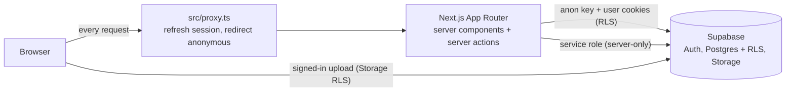

# MyMuseum

MyMuseum is a multi-tenant platform for virtual museums. Each client gets their own museum with halls (categories), framed artworks and a fully customizable look, published at a public link.

- **Halls and artworks**: a museum is a sequence of halls; each hall holds framed artworks with title, author, year and description.
- **2.5D viewer**: a button-only experience (no free camera) with animated gliding between artworks and doorway transitions between halls. Works with touch, mouse and keyboard.
- **Customization**: museum theme presets, accent color and font pairing; per-hall wall, floor, lighting, frame style and floor decorations (carpets, rugs, spotlight pool) plus decor such as rope barriers, benches and plants.
- **Live preview**: the admin editors render the real viewer while you edit.
- **Planned**: export a museum-styled Story image (see [Roadmap](#roadmap)).

## Areas and roles

| Area | Path | Who | Purpose |
| --- | --- | --- | --- |
| Super admin | `/super` | `super_admin` | Onboard clients, manage accounts and museums |
| Museum admin | `/admin` | any active signed-in user (normally `owner`) | Manage own museum: halls, artworks, appearance, settings, publishing |
| Public viewer | `/m/[slug]` | anyone | Visit a published museum |
| Login | `/login` | anyone | Email and password sign-in; redirects by role |

Roles live in `public.profiles.role` (`super_admin` or `owner`). They are never read from user metadata. Disabled accounts (`is_active = false`) cannot sign in and are signed out on their next request.

Super admin features: platform overview, searchable client list, create client (temporary password shown once), edit name, enable/disable, reset password, change email, delete client with typed confirmation (also removes their Storage files), museum list with force unpublish. Impersonation is intentionally not implemented.

## Architecture



- **Next.js 16 App Router**, React 19, Tailwind CSS 4, `motion` for animation, `sonner` for toasts, Zod 4 for validation.
- **Supabase** provides Auth (credentials live in `auth.users` only), Postgres with Row Level Security and the public `artworks` Storage bucket.
- **`src/proxy.ts`** refreshes the session cookie and sends anonymous visitors of `/admin` and `/super` to `/login`. It is only a first line of defence: every page, query and server action verifies the user with `supabase.auth.getUser()` and the role from `profiles` again (`src/lib/auth/session.ts`).
- **Server actions** (`src/app/admin/actions`, `src/app/super/actions.ts`) validate input with Zod, check ownership or role, then mutate. Errors are mapped to safe messages.
- **Theme pipeline**: database rows are resolved into render-ready values and then CSS variables.

```text
museums.theme_preset / accent_color / font_pairing / theme_overrides
        -> resolveMuseumTheme()  (src/lib/theme.ts)   -> CSS variables on the page root
halls.wall_style / floor_style / floor_decoration / lighting / frame / decor
        -> resolveHallStyle()    (src/lib/hall-style.ts) -> viewer scene (src/components/viewer)
```

The admin area uses the same tokens with a fixed neutral palette (`src/lib/admin/theme.ts`), so it stays readable whatever a museum looks like.

## Project structure

```text
src/
  app/
    page.tsx             landing placeholder
    login/               sign-in form, server actions, disabled-account route
    admin/               museum admin: overview, halls, artworks, appearance, settings
      actions/           server actions (museum, halls, artworks)
    super/               super admin: overview, clients, museums, server actions
    m/[slug]/            public viewer
  components/
    admin/               shared admin UI (buttons, fields, nav, previews, pickers)
    super/               super admin UI (password field, credentials panel, pagination)
    viewer/              2.5D scene, frames, decorations, landing, detail view
  lib/
    auth/                getAuthState/requireUser/requireRole, redirect safety
    supabase/            server, browser and service-role clients, storage URLs
    admin/               admin queries, action helpers, admin theme
    super/               super admin queries, guards, validation, password generator
    validation/          Zod schemas and slug rules (reserved slugs)
    theme.ts             museum theme presets and CSS variable resolution
    hall-style.ts        hall style options and resolution
    viewer-model.ts      pure viewer data model
  proxy.ts               session refresh and first-line route protection
  types/database.ts      hand-written row types matching the migrations
supabase/
  migrations/            ordered SQL migrations
  seed.sql               optional demo museum
docs/
  SUPABASE_SETUP.md      step-by-step Supabase setup
  specs/                 original design specs (see status note in each file)
```

## Data model and security

| Table | Key columns |
| --- | --- |
| `profiles` | `id` (= `auth.users.id`), `email`, `display_name`, `role`, `is_active` |
| `museums` | `owner_id`, `slug` (unique, validated, reserved words blocked), `title`, `is_published`, theme columns, `default_hall_id`, `cover_image_path` |
| `halls` | `museum_id`, `name`, `slug`, `sort_order`, wall/floor/lighting/frame styles, `floor_decoration`, `decor`, `is_visible` |
| `artworks` | `museum_id`, `hall_id` (nullable), `title`, `image_path`, aspect ratio, frame options, `sort_order`, `is_active` |

Deleting a user cascades to their profile, museums, halls and artworks. Deleting a hall only unassigns its artworks.

Security model:

- **No passwords in app tables.** Credentials are owned by Supabase Auth. A database trigger creates the `profiles` row for each new auth user with role `owner`; promotion to `super_admin` is manual SQL.
- **RLS on every table.** Anonymous visitors read only published museums, visible halls and active artworks. Owners read and write only their own rows (`owns_museum()`); super admins have explicit policies. A trigger stops non-super-admins from changing `role` or `is_active`.
- **Storage.** Bucket `artworks` is public-read, 10 MB limit, images only. Objects live at `{museum_id}/{file}`; write policies check folder ownership.
- **Service role is server-only.** `SUPABASE_SERVICE_ROLE_KEY` is used by `src/lib/supabase/admin.ts` (marked `server-only`) for creating, updating and deleting auth users and for Storage cleanup. It is never sent to the browser.
- **Super admin guard rails.** Server actions re-check the role on every call; a super admin cannot disable or delete themselves or the last active super admin. Passwords are never logged or stored; a generated password is shown once.

## Getting started

Prerequisites: Node.js 20 or newer, npm, and a [Supabase](https://supabase.com) project.

1. Install dependencies.

   ```bash
   npm install
   ```

2. Create a Supabase project and run the migrations in order (SQL editor or `npx supabase db push`):

   1. `supabase/migrations/20261016000000_initial_schema.sql`
   2. `supabase/migrations/20261016120000_museum_theme.sql`
   3. `supabase/migrations/20261017000000_artwork_frame_nullable.sql`

   Full walkthrough, including RLS checks: [docs/SUPABASE_SETUP.md](docs/SUPABASE_SETUP.md).

3. Create `.env` (copy `.env.example`) with the values from **Project Settings > API**.

   | Variable | Scope | Used for |
   | --- | --- | --- |
   | `NEXT_PUBLIC_SUPABASE_URL` | public | Supabase API URL |
   | `NEXT_PUBLIC_SUPABASE_ANON_KEY` | public | Anonymous key; access is limited by RLS |
   | `SUPABASE_SERVICE_ROLE_KEY` | **server-only** | Creating and managing accounts, Storage cleanup. Bypasses RLS: never expose it |

4. Create your first user in **Authentication > Users > Add user** (check "Auto Confirm User"), then promote it in the SQL editor:

   ```sql
   update public.profiles
   set role = 'super_admin'
   where email = 'you@example.com';
   ```

5. Start the dev server and sign in at <http://localhost:3000/login>. You land on `/super`.

   ```bash
   npm run dev
   ```

6. Create a first client at `/super/clients/new`: email, display name and a generated temporary password, optionally an initial museum title and address. Copy the credentials shown once and give them to the client, who signs in at `/login` and lands on `/admin`.

Optional: run `supabase/seed.sql` in the SQL editor for a published `demo-museum` (requires a super admin).

## Scripts

| Command | Description |
| --- | --- |
| `npm run dev` | Start the development server |
| `npm run build` | Production build |
| `npm run start` | Serve the production build |
| `npm run lint` | ESLint |
| `npm run test` | Unit tests with Vitest |

## Deployment

The app deploys to [Vercel](https://vercel.com) as a standard Next.js project.

- Set `NEXT_PUBLIC_SUPABASE_URL`, `NEXT_PUBLIC_SUPABASE_ANON_KEY` and `SUPABASE_SERVICE_ROLE_KEY` in the project environment variables. Mark the service role key as a server-side secret.
- Never commit `.env` files. Only `.env.example` (names, no values) belongs in the repository.
- Run the SQL migrations against the production Supabase project before the first deploy.

## Roadmap

| Phase | Scope | Status |
| --- | --- | --- |
| 1 | Data layer: schema, RLS, auth trigger, storage bucket | Done |
| 2 | Public 2.5D viewer and theming | Done |
| 3 | Museum admin: halls, artworks, appearance, settings, live preview | Done |
| 4 | Super admin: client onboarding and account management | Done |
| 5 | Story export: museum-styled vertical image of an artwork or hall | Pending |

Known gaps: storage usage per museum is not tracked, and there is no self-service password change for clients yet.

## Contributing

Use [Conventional Commits](https://www.conventionalcommits.org) (`feat:`, `fix:`, `docs:`, `test:`, `refactor:`, `chore:`) with a short scope when helpful, for example `feat(super): add client list filters`. Keep commits small and focused, run `npm run lint`, `npm run test` and `npm run build` before opening a pull request, and never include secrets.
