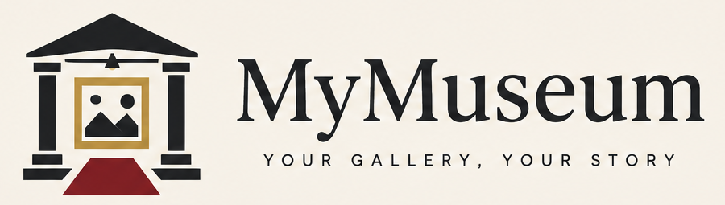
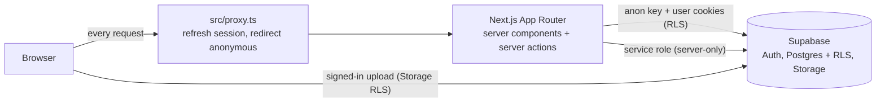

<p align="center">
  
</p>

# MyMuseum

MyMuseum is a multi-tenant platform for virtual museums. The platform owner creates client accounts; each client signs in and creates **their own museum** (exactly one per account) with categories (halls), framed artworks and a fully customizable look, published at a public link.

- **Halls and artworks**: a museum is a sequence of halls; each hall holds framed artworks with title, author, year and description.
- **3D viewer**: visitors open `/m/[slug]` straight inside one continuous museum, rendered in real time with react-three-fiber. The camera runs on rails (no free movement): arrow buttons, the keyboard or a click on an artwork glide it between works and through the archways that separate halls.
- **Customization**: museum theme presets, accent color and font pairing; per-hall wall, floor, lighting, frame style and floor decorations (carpets, rugs, spotlight pool) plus decor such as rope barriers, benches and plants.
- **Live preview**: the studio editors render the same 3D scene (embedded, light quality) while you edit.
- **Languages**: everything is Spanish by default with an English alternative: the login page, the platform admin, the studio and the public viewer. An ES/EN switch (`lang` cookie) sits on the login page and in both panel headers; each museum also has a default language for its visitors (Studio > Settings).
- **Image export**: a real photograph of the 3D museum taken at the artwork's spot (Story 9:16, Post 4:5 or Square 1:1). See [Image export](#image-export).

## Areas and roles

| Area | Path | Who | Purpose |
| --- | --- | --- | --- |
| Platform admin | `/admin` | `super_admin` only | Create and manage client accounts, see every museum (read-only), force unpublish |
| Studio | `/studio` | any active signed-in user | The owner's panel for their one museum: overview, categories, artworks, style, settings, publishing |
| Public viewer | `/m/[slug]` | anyone | Visit a published museum |
| Login | `/login` | anyone | Email and password sign-in; redirects by role |
| Landing | `/` | anyone | A quiet welcome page with a sign-in button |

Sign-in lands a `super_admin` on `/admin` and everybody else on `/studio`. A `super_admin` can also open `/studio` for a museum of their own. A client who opens `/admin` is sent to `/studio`. `/super/*` is the former name of the platform admin and redirects permanently to `/admin/*`; old owner URLs under `/admin` are not redirected (that path now means the platform admin).

Roles live in `public.profiles.role` (`super_admin` or `owner`). They are never read from user metadata. Disabled accounts (`is_active = false`) cannot sign in and are signed out on their next request.

**One museum per user.** A unique index on `museums.owner_id` enforces it. Creating a client never creates a museum: on first sign-in the client sees a short onboarding (museum name, public address with a live availability check, and the name of a starter category) and creates it exactly once. There is no museum selector anywhere.

Platform admin features: overview, searchable client list, create client (generated temporary password shown once), edit name, enable/disable, reset password, change email, delete client with typed confirmation (also removes their Storage files), and a read-only museum list with force unpublish. Impersonation is intentionally not implemented.

In the Spanish interface halls are called **Categorías** and the accounts of the platform **Clientes**; in English they are "categories" and "clients" (the code and the database still say `halls`).

## Architecture



- **Next.js 16 App Router**, React 19, Tailwind CSS 4, `motion` for animation, `sonner` for toasts, Zod 4 for validation.
- **Supabase** provides Auth (credentials live in `auth.users` only), Postgres with Row Level Security and the public `artworks` Storage bucket.
- **`src/proxy.ts`** refreshes the session cookie and sends anonymous visitors of `/admin` and `/studio` to `/login?next=...` (`src/lib/auth/redirects.ts`, unit tested). It is only a first line of defence: every page, query and server action verifies the user with `supabase.auth.getUser()` and the role from `profiles` again (`src/lib/auth/session.ts`: `requireUser`, `requireRole`, `getOwnMuseum`, `requireMuseum`).
- **Server actions** (`src/app/studio/actions`, `src/app/admin/actions.ts`) validate input with Zod, check ownership or role, then mutate. Failures are localized on the server with the request language (`src/lib/action-result.ts`); pure validation helpers return message codes (`val.*`) that the UI translates.
- **Theme pipeline**: database rows are resolved into render-ready values and then CSS variables.

```text
museums.theme_preset / accent_color / font_pairing / theme_overrides
        -> resolveMuseumTheme()  (src/lib/theme.ts)   -> CSS variables on the page root
halls.wall_style / floor_style / floor_decoration / lighting / frame / decor
        -> resolveHallStyle()    (src/lib/hall-style.ts) -> 3D scene (src/components/gallery)
```

Both panels use the same tokens with a fixed neutral light palette (`src/lib/panel-theme.ts`), so they stay readable whatever a museum looks like.

## Project structure

```text
src/
  app/
    page.tsx             landing page
    login/               sign-in form, server actions, disabled-account route
    studio/              owner panel: overview, categories, artworks, style, settings
      actions/           server actions (museum, halls, artworks)
    admin/               platform admin: overview, clients, museums, server actions
    m/[slug]/            public viewer
  components/
    ui/                  shared panel UI (buttons, fields, nav, language switcher, status badge)
    studio/              studio UI (pickers, previews, onboarding, save bar, share card)
    admin/               platform admin UI (password field, credentials panel, pagination, badges)
    gallery/             3D museum: scene, camera rail, frames, portals, lighting, export
    viewer/              CSS frame and wall previews used by the admin pickers
  lib/
    auth/                getAuthState/requireUser/requireRole/getOwnMuseum, route areas and redirect safety
    action-result.ts     localized server-action results
    panel-theme.ts       fixed theme of the panels
    supabase/            server, browser and service-role clients, storage URLs
    studio/              owner data access (own halls and artworks), action helpers, override merging
    admin/               platform admin queries, guards, validation, password generator
    validation/          Zod schemas and slug rules (reserved slugs)
    theme.ts             museum theme presets and CSS variable resolution
    hall-style.ts        hall style options and resolution
    viewer-model.ts      pure viewer data model
    gallery/             pure 3D logic: layout engine, camera rail math, quality tiers, scene look
    photo/               export formats, safe zones, photographic composition
    i18n/                es/en dictionaries (viewer + panels), typed t(), message codes, formatting, locale cookie
  proxy.ts               session refresh and first-line route protection
  types/database.ts      hand-written row types matching the migrations
supabase/
  migrations/            ordered SQL migrations
  seed.sql               optional demo museum
docs/
  SUPABASE_SETUP.md      step-by-step Supabase setup
  specs/                 original design specs (see status note in each file)
```

## Data model and security

| Table | Key columns |
| --- | --- |
| `profiles` | `id` (= `auth.users.id`), `email`, `display_name`, `role`, `is_active` |
| `museums` | `owner_id` (unique: one museum per user), `slug` (unique, validated, reserved words blocked), `title`, `is_published`, theme columns, `default_hall_id`, `cover_image_path` |
| `halls` | `museum_id`, `name`, `slug`, `sort_order`, wall/floor/lighting/frame styles, `floor_decoration`, `decor`, `is_visible` |
| `artworks` | `museum_id`, `hall_id` (nullable), `title`, `image_path`, aspect ratio, frame options, `sort_order`, `is_active` |

Deleting a user cascades to their profile, museum, halls and artworks. Deleting a hall only unassigns its artworks.

Security model:

- **No passwords in app tables.** Credentials are owned by Supabase Auth. A database trigger creates the `profiles` row for each new auth user with role `owner`; promotion to `super_admin` is manual SQL.
- **RLS on every table.** Anonymous visitors read only published museums, visible halls and active artworks. Owners read and write only their own rows (`owns_museum()`); super admins have explicit policies. A trigger stops non-super-admins from changing `role` or `is_active`.
- **Storage.** Bucket `artworks` is public-read, 10 MB limit, images only. Objects live at `{museum_id}/{file}`; write policies check folder ownership.
- **Service role is server-only.** `SUPABASE_SERVICE_ROLE_KEY` is used by `src/lib/supabase/admin.ts` (marked `server-only`) for creating, updating and deleting auth users and for Storage cleanup. It is never sent to the browser.
- **Super admin guard rails.** Server actions re-check the role on every call; a super admin cannot disable or delete themselves or the last active super admin. Passwords are never logged or stored; a generated password is shown once.

## 3D viewer

```text
ViewerMuseum -> galleryZones() -> buildLayout()   (src/lib/gallery, pure and unit tested)
                      |                 |
                      |                 +-> artwork positions, portals, camera stops
                      +-> zoneLook()    wall, floor, decoration, lighting per hall
GalleryScene (src/components/gallery): lights, camera rail, zones, portals, artworks
```

- **One continuous gallery.** Halls are consecutive zones of a long wall. Artwork positions come from their real aspect ratios (equal visual weight, spacing proportional to widths, centers at 1.55 m). Halls are separated by stone archways with the hall name; artworks without a hall form an "Other" zone at the end.
- **Camera on rails.** One stop per artwork plus one per hall entrance. The camera is critically damped (smoothDamp), eased, with a short settling sway and a gaze that trails the body, so travel across halls is continuous. `prefers-reduced-motion` cuts instead of gliding.
- **Materials.** Procedural wall (plaster, brick, concrete, wood, marble, velvet, linen) and floor (parquet, marble, concrete, carpet, dark wood) textures with bump and roughness; real mitred frame mouldings with mat, glass and canvas variants; carpets, rugs, light pools, benches, plants and rope barriers as geometry.
- **Light.** A pool of spotlights follows the artworks nearest the camera (only a few cast shadows), plus hemisphere and fill light blended across halls. The museum theme preset tints the room.
- **Quality tiers** (`src/lib/gallery/quality.ts`): `low`, `medium` and `high` are chosen from the device (memory, cores, pointer, software renderer). Low drops shadows, reflections and props; high adds soft shadows and a floor reflection. `?quality=low|medium|high` forces a tier. Rendering is on demand: a resting camera costs no GPU time, offscreen admin previews are paused, textures are capped per tier and only loaded near the camera, and shaders are compiled in parallel behind the loading screen.
- **Fallback.** Without WebGL, visitors see a notice and a plain list of the artworks.
- **Languages.** Strings live in `src/lib/i18n` (Spanish default; `dictionaries.ts` for the viewer, `panel-es.ts`/`panel-en.ts` for the login page and both panels; a test keeps both languages on the same keys and placeholders). The `lang` cookie is set by a server action; `theme_overrides.defaultLocale` (`es` or `en`, edited in Studio > Settings and validated with Zod; rows without it fall back to `es`) is the museum default for visitors without a cookie.

## Image export

Every artwork can be exported as a photograph of the museum: the same 3D scene the visitor walks through, shot from a camera standing at the artwork's spot with the real walls, floor, carpet, lighting, frame and placard. Nothing is invented and nothing is uploaded; the picture is rendered in the browser.

- **Visitors**: one **Download image** button in the viewer. They only pick a format (Story 9:16 at 1080x1920 with the top 250 px and bottom 340 px kept clear, Post 4:5 at 1080x1350, Square 1:1 at 1080x1080). The title appears on the in-scene placard; a small museum watermark sits at the bottom of the safe area.
- **Owners** (studio, artworks list and editor): the same dialog with a few real scene choices: lighting preset, vignette, film grain, watermark and JPEG. The editor exports the unsaved frame and mat choices.
- **Access control**: `museums.theme_overrides.allowVisitorExport` (default `true`) turns visitor downloads off in **Studio > Style > Sharing**. Owners can always export.
- **Share or download**: the Web Share API with a file where supported, otherwise a download named `{museum}-{artwork}-{format}.png`.

How it works (`src/components/gallery/export`, `src/lib/photo`):

```text
ViewerMuseum + artwork -> composePhoto()     (pure: distance, lens shift, safe zones)
                       -> offscreen react-three-fiber root running GalleryScene (export tier, shadows, reflection)
                       -> finishPhoto()      (vignette, grain, watermark on a 2D canvas)
```

- The camera is level and uses a lens shift, so the artwork sits in the middle of the safe area without converging verticals, and a strip of the real floor stays in frame.
- Photos are loaded with CORS (`crossOrigin="anonymous"`) so the canvas stays untainted; the Supabase public bucket sends the headers.
- The scene is rendered with 1.5x supersampling and downscaled; if the device cannot allocate it, it falls back to 1.25x and 1x.

<!-- DEMO: add GIF here -->

## Getting started

Prerequisites: Node.js 20 or newer, npm, and a [Supabase](https://supabase.com) project.

1. Install dependencies.

   ```bash
   npm install
   ```

2. Create a Supabase project and run the migrations in order (SQL editor or `npx supabase db push`):

   1. `supabase/migrations/20261016000000_initial_schema.sql`
   2. `supabase/migrations/20261016120000_museum_theme.sql`
   3. `supabase/migrations/20261017000000_artwork_frame_nullable.sql`
   4. `supabase/migrations/20261018000000_one_museum_per_user.sql` - one museum per user. It stops with an explanation if any user already owns more than one museum (delete or move the extras, then run it again).

   Full walkthrough, including RLS checks: [docs/SUPABASE_SETUP.md](docs/SUPABASE_SETUP.md).

3. Create `.env` (copy `.env.example`) with the values from **Project Settings > API**.

   | Variable | Scope | Used for |
   | --- | --- | --- |
   | `NEXT_PUBLIC_SUPABASE_URL` | public | Supabase API URL |
   | `NEXT_PUBLIC_SUPABASE_ANON_KEY` | public | Anonymous key; access is limited by RLS |
   | `SUPABASE_SERVICE_ROLE_KEY` | **server-only** | Creating and managing accounts, Storage cleanup. Bypasses RLS: never expose it |

4. Create your first user in **Authentication > Users > Add user** (check "Auto Confirm User"), then promote it in the SQL editor:

   ```sql
   update public.profiles
   set role = 'super_admin'
   where email = 'you@example.com';
   ```

5. Start the dev server and sign in at <http://localhost:3000/login>. You land on `/admin`.

   ```bash
   npm run dev
   ```

6. Create a first client at `/admin/clients/new`: email, display name and a generated temporary password. Copy the credentials shown once and give them to the client. They sign in at `/login`, land on `/studio` and create their own museum there. The interface is in Spanish; use the ES/EN switch for English.

Optional: run `supabase/seed.sql` in the SQL editor for a published `demo-museum` (requires a super admin who does not own a museum yet).

## Scripts

| Command | Description |
| --- | --- |
| `npm run dev` | Start the development server |
| `npm run build` | Production build |
| `npm run start` | Serve the production build |
| `npm run lint` | ESLint |
| `npm run test` | Unit tests with Vitest |

## Deployment

The app deploys to [Vercel](https://vercel.com) as a standard Next.js project.

- Set `NEXT_PUBLIC_SUPABASE_URL`, `NEXT_PUBLIC_SUPABASE_ANON_KEY` and `SUPABASE_SERVICE_ROLE_KEY` in the project environment variables. Mark the service role key as a server-side secret.
- Never commit `.env` files. Only `.env.example` (names, no values) belongs in the repository.
- Run the SQL migrations against the production Supabase project before the first deploy.

## Roadmap

| Phase | Scope | Status |
| --- | --- | --- |
| 1 | Data layer: schema, RLS, auth trigger, storage bucket | Done |
| 2 | Public 2.5D viewer and theming | Done |
| 3 | Museum admin: halls, artworks, appearance, settings, live preview | Done |
| 4 | Super admin: client onboarding and account management | Done |
| 5 | Image export of an artwork (replaced in 6A by real 3D photographs) | Done |
| 6A | Real-time 3D viewer on rails, Spanish/English viewer, 3D admin previews and photo export | Done |
| 6B | Platform admin at `/admin`, owner studio at `/studio`, one museum per user, Spanish-first panels | Done |

Known gaps: storage usage per museum is not tracked, and there is no self-service password change for clients yet.

## Contributing

Use [Conventional Commits](https://www.conventionalcommits.org) (`feat:`, `fix:`, `docs:`, `test:`, `refactor:`, `chore:`) with a short scope when helpful, for example `feat(super): add client list filters`. Keep commits small and focused, run `npm run lint`, `npm run test` and `npm run build` before opening a pull request, and never include secrets.
