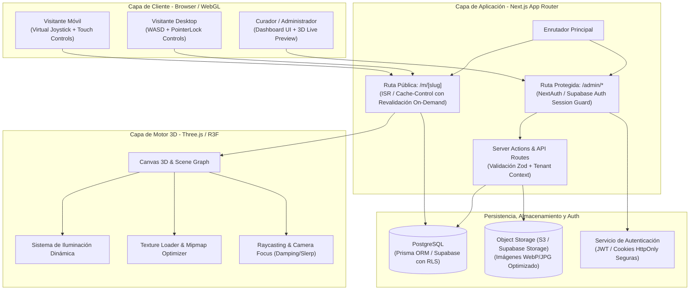

# 01 - Especificación de Arquitectura de Sistema

> **Status: superseded.** This spec is superseded. It describes an earlier design (NextAuth, Prisma, a WebGL/3D engine). The current architecture is Next.js App Router + Supabase (Auth, Postgres with RLS, Storage) and a 2.5D button-only viewer. See the root README.md and docs/SUPABASE_SETUP.md.

## 1. Visión General y Objetivos
**Mi Museo** es una plataforma web *multi-tenant* diseñada para que artistas, curadores, galerías y entusiastas puedan registrarse, diseñar su propia galería 3D interactiva en tiempo real, subir obras de arte y compartir una URL pública (`/m/[slug]`) accesible desde cualquier navegador moderno (Desktop, Tablet y Mobile) sin requerir instalación de plugins.

### Principios de Arquitectura
1. **Spec-First & Type-Safe**: Tipado estricto de extremo a extremo mediante TypeScript, contratos de datos validados con Zod y esquemas sincronizados.
2. **Aislamiento Multi-Tenant Estricto**: Particionamiento lógico de datos a nivel de base de datos (`tenant_id` / `museum_id`) y autorización rigurosa en cada operación de mutación.
3. **Alto Rendimiento 3D Web**: Renderizado fluido a 60 FPS garantizado en dispositivos móviles y de escritorio mediante gestión eficiente de texturas (mipmapping, compresión), reutilización de geometrías/materiales y *culling*.
4. **Separación de Responsabilidades**: Desacoplamiento entre el motor de renderizado 3D (React Three Fiber / Three.js), la lógica de dominio (Next.js Server Actions / API Routes) y la persistencia de datos.

---

## 2. Diagrama de Arquitectura del Sistema

---

## 3. Stack Tecnológico Recomendado y Justificación

| Capa / Componente | Tecnología | Justificación Técnica |
| :--- | :--- | :--- |
| **Framework Full-Stack** | **Next.js (App Router, React 19 / 18, TypeScript)** | Soporte nativo para Server Components, Server Actions type-safe, generación estática/ISR para museos públicos (`/m/[slug]`) y excelente ecosistema. |
| **Motor 3D** | **Three.js + React Three Fiber (R3F) + @react-three/drei** | R3F permite modelar la escena 3D como componentes declarativos de React sin perder el acceso directo al ciclo de renderizado nativo de Three.js. Drei provee utilidades estandarizadas (`PointerLockControls`, loaders, luces, post-processing). |
| **Estilos & UI** | **Tailwind CSS + Lucide Icons + Radix UI / Shadcn UI** | Sistema de diseño modular, accesible, ligero y sin sobrecarga de runtime, ideal para el dashboard administrativo y modales de inspección de obras en el canvas. |
| **Persistencia de Datos** | **PostgreSQL + Prisma ORM** | Modelo relacional robusto para vincular usuarios, museos, configuraciones y obras. Prisma garantiza migraciones seguras y tipado estricto en tiempo de compilación. |
| **Almacenamiento de Medios** | **Cloudinary o AWS S3 / Supabase Storage** | Almacenamiento seguro de activos multimedia con pipeline de transformación (redimensionamiento a potencias de dos para WebGL, compresión WebP/AVIF y generación de miniaturas). |
| **Autenticación** | **NextAuth.js (Auth.js v5) o Supabase Auth** | Autenticación basada en sesiones seguras con cookies HttpOnly, soporte para credenciales (email/password) y proveedores OAuth (Google, GitHub). |
| **Validación de Datos** | **Zod** | Esquemas unificados para validación de formularios en el cliente y sanitización en Server Actions / API endpoints. |

---

## 4. Estrategia de Multi-Tenancy

### 4.1. Modelo de Particionamiento Lógico
La aplicación implementa un esquema de **Aislamiento por Tenant Lógico Compartido (Shared Database, Pooled Schema)**:
- Cada registro en las tablas `Museums`, `Artworks` y `MuseumSettings` está estrictamente vinculado a un identificador único de inquilino (`tenant_id` / `museum_id`).
- La tabla central de aislamiento es `Museums`, cuya clave foránea directa es `user_id` (Owner).
- Las consultas en el panel administrativo filtran obligatoriamente por la tupla `(museum_id, user_id)` obtenida de la sesión validada del servidor, previniendo vulnerabilidades de asignación masiva o IDOR (*Insecure Direct Object References*).

### 4.2. Enrutamiento por Slug (`/m/[slug]`)
1. **Resolución de Dominio/Slug**:
   - URL canónica: `https://mimuseo.com/m/[slug]`
   - El segmento dinámico `[slug]` es indexado con restricción única (`UNIQUE INDEX`) en PostgreSQL.
   - Sanitización de slugs: Solo caracteres alfanuméricos en minúsculas y guiones medios (`/^[a-z0-9]+(?:-[a-z0-9]+)*$/`), con lista negra de palabras reservadas (`admin`, `api`, `dashboard`, `settings`, `login`, `register`, `static`).
2. **Estrategia de Caché y Renderizado**:
   - **ISR (Incremental Static Regeneration)**: Las páginas públicas de los museos se pre-renderizan y almacenan en caché con una política de revalidación basada en tags (`revalidateTag('museum-[slug]')`).
   - Al guardar cambios en el panel de administración (color de paredes, marcos o agregar cuadros), se dispara la revalidación on-demand inmediata, logrando tiempos de carga sub-100ms para visitantes sin impactar la base de datos.
3. **Escalabilidad a Subdominios Personalizados (Future-Ready)**:
   - El middleware de Next.js (`middleware.ts`) está diseñado para interceptar solicitudes de subdominios (`[slug].mimuseo.com`) y reescribirlas internamente a `/m/[slug]`, permitiendo habilitar dominios personalizados sin alterar la lógica de negocio.

---

## 5. Estrategia de Seguridad y Gobernanza de Datos
1. **Control de Acceso Basado en Roles (RBAC)**:
   - `OWNER`: Control total del museo, facturación, eliminación y modificación de obras.
   - `CURATOR` (Opcional a futuro): Capacidad de organizar obras y ajustar iluminación/marcos.
   - `VISITOR`: Acceso de solo lectura a través de la ruta `/m/[slug]`.
2. **Políticas de Carga de Archivos**:
   - Validación de tipos MIME en el servidor (`image/jpeg`, `image/png`, `image/webp`).
   - Límite estricto de tamaño por archivo (máximo 10 MB por obra de arte).
   - Sanitización de metadatos EXIF previo al guardado para proteger la privacidad del usuario.
