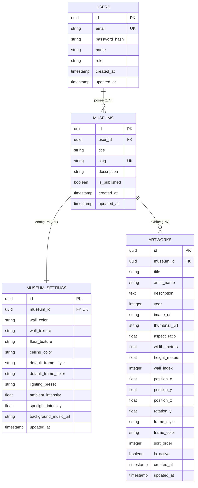

# 02 - Especificación de Base de Datos y Persistencia

> **Status: superseded.** This spec is superseded. It describes a Prisma schema with application-managed credentials. The real schema is in supabase/migrations/ (Supabase Auth owns credentials; `profiles` has no password column). See the root README.md.

## 1. Visión General del Modelo de Datos
El almacenamiento de **Mi Museo** está estructurado sobre un esquema relacional normalizado con soporte estricto para aislamiento multi-inquilino (*multi-tenancy*). Cada museo pertenece a un usuario propietario, y todas las configuraciones de escena 3D y obras de arte se encuentran segregadas por el identificador del museo (`museum_id`).

---

## 2. Diagrama Entidad-Relación (ERD)



---

## 3. Diccionario de Datos Detallado

### 3.1. Entidad: `users`
Almacena las credenciales y perfiles de los usuarios que administran museos.

| Campo | Tipo | Nulo | Por Defecto | Descripción |
| :--- | :--- | :--- | :--- | :--- |
| `id` | `UUID` | No | `gen_random_uuid()` | Identificador único del usuario. Clave primaria. |
| `email` | `VARCHAR(255)` | No | - | Correo electrónico único del usuario. |
| `password_hash` | `VARCHAR(255)` | No | - | Hash seguro de la contraseña (bcrypt/argon2). |
| `name` | `VARCHAR(100)` | No | - | Nombre público o de visualización del curador. |
| `role` | `VARCHAR(20)` | No | `'USER'` | Rol del usuario (`ADMIN`, `USER`). |
| `created_at` | `TIMESTAMPTZ` | No | `NOW()` | Fecha y hora de creación. |
| `updated_at` | `TIMESTAMPTZ` | No | `NOW()` | Fecha y hora de última actualización. |

### 3.2. Entidad: `museums`
Representa el museo o galería virtual creado por un usuario. Es el contenedor del tenant.

| Campo | Tipo | Nulo | Por Defecto | Descripción |
| :--- | :--- | :--- | :--- | :--- |
| `id` | `UUID` | No | `gen_random_uuid()` | Identificador único del museo. Clave primaria. |
| `user_id` | `UUID` | No | - | Referencia al usuario propietario (`users.id`). |
| `title` | `VARCHAR(150)` | No | - | Nombre visible de la galería (ej: "Galería de Arte Moderno"). |
| `slug` | `VARCHAR(100)` | No | - | Slug único para acceso público (`/m/[slug]`). |
| `description` | `TEXT` | Sí | `NULL` | Breve biografía o reseña curatorial del museo. |
| `is_published` | `BOOLEAN` | No | `true` | Determina si el museo es visible públicamente. |
| `created_at` | `TIMESTAMPTZ` | No | `NOW()` | Fecha y hora de creación. |
| `updated_at` | `TIMESTAMPTZ` | No | `NOW()` | Fecha y hora de última modificación. |

### 3.3. Entidad: `museum_settings`
Configuración estética, arquitectónica y lumínica de la escena 3D del museo.

| Campo | Tipo | Nulo | Por Defecto | Descripción |
| :--- | :--- | :--- | :--- | :--- |
| `id` | `UUID` | No | `gen_random_uuid()` | Clave primaria. |
| `museum_id` | `UUID` | No | - | FK a `museums.id`, con restricción `UNIQUE` (1:1). |
| `wall_color` | `VARCHAR(7)` | No | `'#EAEAEA'` | Color hexadecimal de las paredes del museo. |
| `wall_texture` | `VARCHAR(50)` | No | `'plaster_smooth'`| Identificador de textura de pared (`smooth`, `concrete`, `brick`). |
| `floor_texture` | `VARCHAR(50)` | No | `'wood_parquet'` | Textura del piso (`wood_parquet`, `polished_marble`, `concrete`). |
| `ceiling_color`| `VARCHAR(7)` | No | `'#FFFFFF'` | Color hexadecimal del techo. |
| `default_frame_style` | `VARCHAR(30)` | No | `'minimalist'` | Estilo de marco predeterminado (`minimalist`, `wood`, `gold`, `metallic`, `canvas_wrap`). |
| `default_frame_color` | `VARCHAR(7)` | No | `'#1A1A1A'` | Color hexadecimal predeterminado del marco. |
| `lighting_preset` | `VARCHAR(30)` | No | `'warm_gallery'` | Perfil de iluminación (`warm_gallery`, `cold_contemporary`, `neon_noir`, `dramatic_spotlight`). |
| `ambient_intensity` | `FLOAT` | No | `0.4` | Nivel de luz ambiental (rango 0.1 a 1.5). |
| `spotlight_intensity` | `FLOAT` | No | `1.2` | Nivel de intensidad de focos direccionales. |
| `background_music_url` | `VARCHAR(500)`| Sí | `NULL` | URL opcional para música ambiental de fondo. |
| `updated_at` | `TIMESTAMPTZ` | No | `NOW()` | Fecha y hora de última actualización. |

### 3.4. Entidad: `artworks`
Obras de arte colgadas dentro del espacio tridimensional.

| Campo | Tipo | Nulo | Por Defecto | Descripción |
| :--- | :--- | :--- | :--- | :--- |
| `id` | `UUID` | No | `gen_random_uuid()` | Clave primaria. |
| `museum_id` | `UUID` | No | - | FK a `museums.id` (Aislamiento por Tenant). |
| `title` | `VARCHAR(200)` | No | - | Título de la obra. |
| `artist_name` | `VARCHAR(150)` | No | `'Desconocido'` | Nombre del autor/artista. |
| `description` | `TEXT` | Sí | `NULL` | Descripción o ficha técnica de la obra. |
| `year` | `INTEGER` | Sí | `NULL` | Año de creación de la obra. |
| `image_url` | `VARCHAR(500)` | No | - | URL de la imagen en alta resolución optimizada. |
| `thumbnail_url` | `VARCHAR(500)` | Sí | `NULL` | URL de la miniatura para la interfaz administrativa. |
| `aspect_ratio` | `FLOAT` | No | `1.0` | Relación de aspecto calculada (`width / height`). |
| `width_meters` | `FLOAT` | No | `1.5` | Ancho en metros virtuales dentro del espacio 3D. |
| `height_meters` | `FLOAT` | No | `1.5` | Alto en metros virtuales dentro del espacio 3D. |
| `wall_index` | `INTEGER` | No | `0` | Identificador de la pared donde se ubica el cuadro. |
| `position_x` | `FLOAT` | No | `0.0` | Posición X en el sistema de coordenadas de la pared. |
| `position_y` | `FLOAT` | No | `1.6` | Posición Y (altura estándar visual del ojo humano: 1.6m). |
| `position_z` | `FLOAT` | No | `0.0` | Posición Z en el sistema de coordenadas de la pared. |
| `rotation_y` | `FLOAT` | No | `0.0` | Rotación en radianes sobre el eje Y para alinear con la pared. |
| `frame_style` | `VARCHAR(30)` | Sí | `NULL` | Sobrescribe el estilo de marco global si no es nulo. |
| `frame_color` | `VARCHAR(7)` | Sí | `NULL` | Sobrescribe el color de marco global si no es nulo. |
| `sort_order` | `INTEGER` | No | `0` | Orden de recorrido sugerido o de renderizado. |
| `is_active` | `BOOLEAN` | No | `true` | Determina si la obra está colgada y activa. |
| `created_at` | `TIMESTAMPTZ` | No | `NOW()` | Fecha y hora de creación. |
| `updated_at` | `TIMESTAMPTZ` | No | `NOW()` | Fecha y hora de última modificación. |

---

## 4. Esquema Completo de Prisma (`schema.prisma`)

```prisma
datasource db {
  provider = "postgresql"
  url      = env("DATABASE_URL")
}

generator client {
  provider = "prisma-client-js"
}

enum Role {
  USER
  ADMIN
}

enum FrameStyle {
  MINIMALIST
  WOOD
  GOLD
  METALLIC
  CANVAS_WRAP
}

enum LightingPreset {
  WARM_GALLERY
  COLD_CONTEMPORARY
  NEON_NOIR
  DRAMATIC_SPOTLIGHT
}

model User {
  id            String    @id @default(uuid()) @db.Uuid
  email         String    @unique @db.VarChar(255)
  passwordHash  String    @map("password_hash") @db.VarChar(255)
  name          String    @db.VarChar(100)
  role          Role      @default(USER)
  createdAt     DateTime  @default(now()) @map("created_at") @db.Timestamptz
  updatedAt     DateTime  @updatedAt @map("updated_at") @db.Timestamptz

  museums       Museum[]

  @@map("users")
}

model Museum {
  id          String          @id @default(uuid()) @db.Uuid
  userId      String          @map("user_id") @db.Uuid
  title       String          @db.VarChar(150)
  slug        String          @unique @db.VarChar(100)
  description String?         @db.Text
  isPublished Boolean         @default(true) @map("is_published")
  createdAt   DateTime        @default(now()) @map("created_at") @db.Timestamptz
  updatedAt   DateTime        @updatedAt @map("updated_at") @db.Timestamptz

  user        User            @relation(fields: [userId], references: [id], onDelete: Cascade)
  settings    MuseumSettings?
  artworks    Artwork[]

  @@index([slug], name: "idx_museums_slug")
  @@index([userId], name: "idx_museums_user_id")
  @@map("museums")
}

model MuseumSettings {
  id                 String         @id @default(uuid()) @db.Uuid
  museumId           String         @unique @map("museum_id") @db.Uuid
  wallColor          String         @default("#EAEAEA") @map("wall_color") @db.VarChar(7)
  wallTexture        String         @default("plaster_smooth") @map("wall_texture") @db.VarChar(50)
  floorTexture       String         @default("wood_parquet") @map("floor_texture") @db.VarChar(50)
  ceilingColor       String         @default("#FFFFFF") @map("ceiling_color") @db.VarChar(7)
  defaultFrameStyle  FrameStyle     @default(MINIMALIST) @map("default_frame_style")
  defaultFrameColor  String         @default("#1A1A1A") @map("default_frame_color") @db.VarChar(7)
  lightingPreset     LightingPreset @default(WARM_GALLERY) @map("lighting_preset")
  ambientIntensity   Float          @default(0.4) @map("ambient_intensity")
  spotlightIntensity Float          @default(1.2) @map("spotlight_intensity")
  backgroundMusicUrl String?        @map("background_music_url") @db.VarChar(500)
  updatedAt          DateTime       @updatedAt @map("updated_at") @db.Timestamptz

  museum             Museum         @relation(fields: [museumId], references: [id], onDelete: Cascade)

  @@map("museum_settings")
}

model Artwork {
  id           String      @id @default(uuid()) @db.Uuid
  museumId     String      @map("museum_id") @db.Uuid
  title        String      @db.VarChar(200)
  artistName   String      @default("Desconocido") @map("artist_name") @db.VarChar(150)
  description  String?     @db.Text
  year         Int?
  imageUrl     String      @map("image_url") @db.VarChar(500)
  thumbnailUrl String?     @map("thumbnail_url") @db.VarChar(500)
  aspectRatio  Float       @default(1.0) @map("aspect_ratio")
  widthMeters  Float       @default(1.5) @map("width_meters")
  heightMeters Float       @default(1.5) @map("height_meters")
  wallIndex    Int         @default(0) @map("wall_index")
  positionX    Float       @default(0.0) @map("position_x")
  positionY    Float       @default(1.6) @map("position_y")
  positionZ    Float       @default(0.0) @map("position_z")
  rotationY    Float       @default(0.0) @map("rotation_y")
  frameStyle   FrameStyle? @map("frame_style")
  frameColor   String?     @map("frame_color") @db.VarChar(7)
  sortOrder    Int         @default(0) @map("sort_order")
  isActive     Boolean     @default(true) @map("is_active")
  createdAt    DateTime    @default(now()) @map("created_at") @db.Timestamptz
  updatedAt    DateTime    @updatedAt @map("updated_at") @db.Timestamptz

  museum       Museum      @relation(fields: [museumId], references: [id], onDelete: Cascade)

  @@index([museumId, isActive], name: "idx_artworks_museum_active")
  @@index([museumId, wallIndex], name: "idx_artworks_museum_wall")
  @@map("artworks")
}
```

---

## 5. Índices de Rendimiento y Claves Foráneas

1. **`idx_museums_slug` (`UNIQUE`)**:
   - Resuelve en $O(1)$ la consulta pública del museo al acceder a `/m/[slug]`.
2. **`idx_museums_user_id`**:
   - Acelera la carga de la lista de museos propios en el Dashboard del curador.
3. **`idx_artworks_museum_active`**:
   - Índice compuesto `(museum_id, is_active)`. Optimiza la recuperación de todas las obras activas al cargar la escena 3D pública sin evaluar obras archivadas.
4. **`idx_artworks_museum_wall`**:
   - Índice compuesto `(museum_id, wall_index)`. Permite consultar de forma eficiente la ocupación de espacios y paredes disponibles.

---

## 6. Políticas de Seguridad y Row Level Security (RLS)

Si se utiliza PostgreSQL con Supabase o RLS nativo, se aplican las siguientes políticas:

```sql
-- Habilitar RLS en todas las tablas
ALTER TABLE museums ENABLE ROW LEVEL SECURITY;
ALTER TABLE museum_settings ENABLE ROW LEVEL SECURITY;
ALTER TABLE artworks ENABLE ROW LEVEL SECURITY;

-- 1. Políticas para MUSEUMS
CREATE POLICY "Public museums are viewable by everyone" 
ON museums FOR SELECT 
USING (is_published = true);

CREATE POLICY "Users can manage their own museums" 
ON museums FOR ALL 
USING (auth.uid() = user_id);

-- 2. Políticas para MUSEUM_SETTINGS
CREATE POLICY "Public museum settings are viewable by everyone" 
ON museum_settings FOR SELECT 
USING (EXISTS (
  SELECT 1 FROM museums 
  WHERE museums.id = museum_settings.museum_id AND museums.is_published = true
));

CREATE POLICY "Users can manage their own museum settings" 
ON museum_settings FOR ALL 
USING (EXISTS (
  SELECT 1 FROM museums 
  WHERE museums.id = museum_settings.museum_id AND museums.user_id = auth.uid()
));

-- 3. Políticas para ARTWORKS
CREATE POLICY "Public artworks are viewable by everyone" 
ON artworks FOR SELECT 
USING (is_active = true AND EXISTS (
  SELECT 1 FROM museums 
  WHERE museums.id = artworks.museum_id AND museums.is_published = true
));

CREATE POLICY "Users can manage artworks in their own museums" 
ON artworks FOR ALL 
USING (EXISTS (
  SELECT 1 FROM museums 
  WHERE museums.id = artworks.museum_id AND museums.user_id = auth.uid()
));
```
