# 05 - Plan de Implementación Incremental (Roadmap)

## 1. Metodología de Ejecución
Siguiendo los principios de **Spec-First Development** y desarrollo incremental, la plataforma **Mi Museo** se construirá dividida en **5 Hitos Clave (Milestones)**. Cada hito agrupa tareas atómicas con criterios de aceptación explícitos y pruebas de verificación antes de avanzar al siguiente.

---

## 2. Desglose de Hitos y Tareas Atómicas

```mermaid
gantt
    title Roadmap de Construcción - Mi Museo
    dateFormat  X
    axisFormat  Día %d

    section Hito 1: Setup & Data Layer
    Inicialización de Proyecto & Tooling       :h1_1, 0, 1
    Modelo Prisma, Migraciones & Seed          :h1_2, 1, 2
    Servicio de Autenticación & Multi-Tenancy  :h1_3, 2, 3

    section Hito 2: Motor 3D Base
    Scene Graph & Arquitectura de Galería 3D   :h2_1, 3, 5
    Sistema de Iluminación & Materiales        :h2_2, 5, 6
    Controles Desktop (WASD/PointerLock)       :h2_3, 6, 7
    Controles Móviles (Joystick/Touch)         :h2_4, 7, 8

    section Hito 3: Marcos & Obras 3D
    Generador de Marcos Procedurales           :h3_1, 8, 9
    Carga de Texturas & Mipmapping             :h3_2, 9, 10
    Raycasting, Enfoque Cinemático & Modal     :h3_3, 10, 11

    section Hito 4: Panel Admin & Live Preview
    Dashboard UI & Gestión de Obras            :h4_1, 11, 13
    Upload de Imágenes con Detección de Aspecto:h4_2, 13, 14
    Personalizador con Live 3D Preview         :h4_3, 14, 15

    section Hito 5: Rutas Públicas & Pulido
    Ruta Pública /m/[slug] con ISR             :h5_1, 15, 16
    Optimización de FPS & Pruebas E2E          :h5_2, 16, 17
```

---

### Hito 1: Inicialización, Arquitectura Base y Capa de Datos
**Objetivo**: Establecer la estructura del proyecto Next.js con TypeScript, configurar Tailwind CSS, inicializar Prisma con PostgreSQL/SQLite local para desarrollo y garantizar el modelo de autenticación y multi-tenancy.

- [ ] **Tarea 1.1**: Inicializar aplicación Next.js (App Router, TypeScript estricto, ESLint, Tailwind CSS, Lucide Icons).
- [ ] **Tarea 1.2**: Configurar cliente Prisma ORM y definir el esquema completo de base de datos (`User`, `Museum`, `MuseumSettings`, `Artwork`).
- [ ] **Tarea 1.3**: Ejecutar migraciones iniciales y crear script de `seed.ts` con un museo de demostración curado con obras públicas de dominio abierto (ej. Museo de Bellas Artes virtual).
- [ ] **Tarea 1.4**: Configurar sistema de autenticación básico y contexto de tenant seguro.
- **Criterio de Aceptación**: Base de datos funcional, pruebas de consulta de Prisma exitosas y script de semillas ejecutado sin errores.

---

### Hito 2: Motor 3D Base y Sistema de Movimiento
**Objetivo**: Construir el entorno virtual tridimensional básico de la galería en Three.js / React Three Fiber con soporte completo para navegación en escritorio y dispositivos móviles.

- [ ] **Tarea 2.1**: Crear componente contenedor `<GalleryCanvas />` con configuración óptima de WebGL, pixel ratio adaptativo y cámara en perspectiva.
- [ ] **Tarea 2.2**: Modelar las paredes de la galería, suelo con textura y techo con ranuras de iluminación.
- [ ] **Tarea 2.3**: Implementar sistema de luces con soporte para los 4 perfiles lumínicos (`warm_gallery`, `cold_contemporary`, `neon_noir`, `dramatic_spotlight`).
- [ ] **Tarea 2.4**: Desarrollar controlador de movimiento para Desktop: `WASD` + `PointerLockControls` con amortiguación inercial (*smooth damping*).
- [ ] **Tarea 2.5**: Desarrollar controlador táctil para Mobile: Virtual Joystick en zona izquierda de pantalla y arrastre en zona derecha para orientación.
- **Criterio de Aceptación**: Navegación fluida dentro de la sala a 60 FPS estables sin caídas de cuadros en Desktop y Mobile.

---

### Hito 3: Renderizado de Marcos 3D, Obras y Raycasting Interactivo
**Objetivo**: Dotar a la galería de la capacidad de desplegar obras dinámicas con marcos 3D configurables, texturas optimizadas y experiencia interactiva de inspección al hacer clic.

- [ ] **Tarea 3.1**: Crear componente procedural `<ArtworkFrame />` con soporte para los 5 estilos de marco (`MINIMALIST`, `WOOD`, `GOLD`, `METALLIC`, `CANVAS_WRAP`) adaptables a cualquier aspecto de imagen.
- [ ] **Tarea 3.2**: Implementar sistema de carga de texturas con mipmapping y manejo de estado de carga (loader visual / spinner elegante en la pared).
- [ ] **Tarea 3.3**: Diseñar sistema de interacción por `Raycaster`: detección de puntero, retícula interactiva y efecto *glow/hover* en la obra enfocada.
- [ ] **Tarea 3.4**: Implementar transición cinemática de cámara (interpolación suave hacia el frente del cuadro seleccionado) y apertura del panel de detalles en el DOM.
- **Criterio de Aceptación**: Al hacer clic en cualquier obra, la cámara se traslada suavemente frente al cuadro y se abre la ficha con la información curatorial; al presionar Escape o cerrar el modal, la cámara vuelve a su modo de exploración.

---

### Hito 4: Panel de Administración y Personalizador en Tiempo Real
**Objetivo**: Construir el Dashboard privado donde el curador gestiona sus cuadros, sube imágenes y edita la estética del museo con previsualización en vivo.

- [ ] **Tarea 4.1**: Crear layout del Dashboard administrativo con navegación entre Obras, Diseño y Ajustes Generales.
- [ ] **Tarea 4.2**: Implementar componente de subida de imágenes con validación de tipo, procesamiento de relación de aspecto en el cliente y guardado en servidor.
- [ ] **Tarea 4.3**: Construir interfaz CRUD para obras: formulario de metadatos (título, artista, año, descripción) y asignación a una pared/slot.
- [ ] **Tarea 4.4**: Desarrollar el personalizador visual dividido (Split View): controles de color de pared, marcos e iluminación a la izquierda y mini-visor 3D en tiempo real a la derecha.
- [ ] **Tarea 4.5**: Implementar Server Actions con validación Zod y retroalimentación inmediata (*toast notifications*).
- **Criterio de Aceptación**: El usuario puede subir una obra, asignarle marco y pared, ajustar el color del museo y ver reflejados los cambios al instante en el mini-visor 3D.

---

### Hito 5: Rutas Públicas Multi-Tenant, Rendimiento y Validación Final
**Objetivo**: Exponer las galerías públicas mediante URLs dinámicas amigables (`/m/[slug]`), optimizar tiempos de carga inicial y asegurar la robustez de la aplicación completa.

- [ ] **Tarea 5.1**: Implementar página pública `/m/[slug]` con Server Components para la carga de datos del museo y renderizado del `<MuseumViewer />`.
- [ ] **Tarea 5.2**: Configurar revalidación de caché bajo demanda (`revalidateTag`) tras modificaciones en el panel de administración.
- [ ] **Tarea 5.3**: Realizar auditoría de rendimiento WebGL (reducción de draw calls, verificación de *dispose* de texturas al desmontar vistas, optimización de bundles).
- [ ] **Tarea 5.4**: Pruebas de compatibilidad multi-dispositivo y responsive en navegadores Chrome, Firefox, Safari y móviles (iOS/Android).
- **Criterio de Aceptación**: Acceso instantáneo a la URL pública de cualquier museo publicado, navegación inmersiva completa y validación integral de pruebas.
